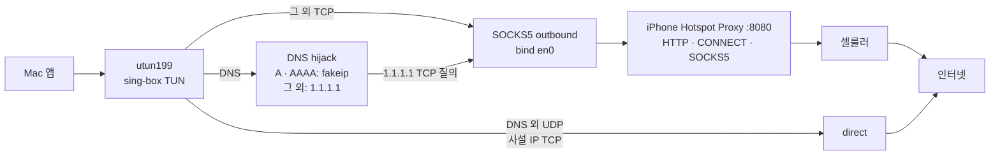

한국어 · [English](docs/README.en.md)

<p align="center">
  
</p>

<h1 align="center">Hotspot Proxy</h1>

<p align="center">
  iPhone 핫스팟을 프록시로 바꿔 맥 트래픽을 iPhone 자체 통신으로 위장한다.<br>
  <sub>Fork of <a href="https://github.com/Indosaram/hotspot-proxy">Indosaram/hotspot-proxy</a> · iOS 26 · IPv6 전용 통신사 대응</sub>
</p>

<p align="center">
  
  
  
  <a href="https://github.com/Indosaram/hotspot-proxy"></a>
</p>

## 왜 쓰나

통신사는 핫스팟(테더링) 트래픽을 따로 분류해 속도를 제한하거나 용량을 별도로 센다. 이 앱은 iPhone 안에서 HTTP · HTTPS(CONNECT) · SOCKS5 프록시를 띄운다. 맥이 그 프록시를 거쳐 나가면 통신사 입장에서는 iPhone 자체 트래픽으로 보인다.

맥 쪽 스크립트는 핫스팟에 붙는 순간 sing-box TUN을 켜서 시스템 전체의 TCP 트래픽과 DNS를 프록시로 보내고, 핫스팟을 벗어나면 원래대로 되돌린다. 수동 설정이 없다.

## 스크린샷

<table>
  <tr><th>Main (running)</th><th>Hotspot off</th><th>Settings</th><th>Welcome</th></tr>
  <tr>
    <td></td>
    <td></td>
    <td></td>
    <td></td>
  </tr>
  <tr>
    <td></td>
    <td></td>
    <td></td>
    <td></td>
  </tr>
</table>


## 어떻게 동작하나



- 맥이 iPhone 핫스팟에 붙으면 launchd 감시 데몬이 sing-box TUN 인터페이스 `utun199`를 켠다. 감시 데몬은 Wi-Fi DNS도 TUN 주소 `172.19.0.2`로 바꾼다.
- TUN은 모든 DNS 질의를 가로챈다. A · AAAA 질의에는 fakeip가 가짜 주소로 답한다. 그 주소로 가는 연결은 도메인 이름을 실은 채 프록시로 나가서 iPhone이 실제 이름을 해석한다. 나머지 질의는 1.1.1.1에 TCP로 묻고, 이 질의도 프록시를 거친다.
- 나머지 TCP는 iPhone 프록시로 나간다. 사설 IP로 가는 TCP와 DNS가 아닌 UDP는 프록시를 거치지 않는다. 링크로컬 주소에서는 SOCKS5 UDP ASSOCIATE가 실패하므로 UDP를 뺀다.
- 핫스팟을 벗어나면 감시 데몬이 sing-box를 내리고 DNS를 비운다.

iOS 26에서 IPv6 전용 통신사를 쓰면 핫스팟이 맥에 `192.0.0.2`를 주고 게이트웨이 `192.0.0.1`은 가상 주소라 iPhone 앱이 응답하지 않는다. 앱은 iPhone의 IPv6 링크로컬 주소에서만 응답한다. 이것이 원본이 동작하지 않던 이유였다.

## 요구 사항

> [!IMPORTANT]
> 유료 Apple 개발자 계정이 필요하다. 무료 Personal Team은 App Group 권한을 서명하지 못한다. 유료 계정의 개발용 서명은 1년 유효하다.

- iPhone: iOS 17 이상, 개발자 모드.
- Mac: Xcode 26.x, Homebrew, `xcodegen`, `sing-box`. Xcode SDK는 iPhone의 iOS 버전과 맞아야 한다.

## 빠른 시작

### 1. iPhone 앱

```bash
brew install xcodegen
cp signing.env.example signing.env      # 팀 ID와 번들 접두를 적는다
bash scripts/generate.sh
open HotspotProxy.xcodeproj
```

Xcode에서 팀 계정으로 로그인하고 iPhone을 대상으로 Run을 누른다. 처음 한 번은 USB로 연결해 "이 컴퓨터를 신뢰"를 누른다. 이후에는 같은 Wi-Fi에서 무선으로 설치된다. 터미널만으로 하는 절차는 [docs/BUILD.md](docs/BUILD.md)에 있다.

**성공 확인:** iPhone 홈 화면에 Hotspot Proxy 아이콘이 생기고, 탭하면 앱이 열린다.

### 2. Mac 자동 전환

```bash
brew install sing-box
sudo bash mac/install.sh
```

**성공 확인:** `install.sh`가 마지막 줄에 `TUN on` 또는 `Standing by …`를 출력한다. 이후 `launchctl print system/com.indo.hotspot-tun.watch`는 `last exit code = 0`을 보인다. 이 데몬은 30초마다 실행되고 끝나므로 평소 `state = not running`이 정상이다.

### 3. 사용

> [!IMPORTANT]
> iPhone 설정 › 개인용 핫스팟 화면을 열어 둔다. 이 화면이 닫혀 있으면 맥에서 핫스팟이 검색되지 않는다.
>
> 맥 Wi-Fi의 수동 프록시는 비워 둔다. 수동 프록시가 남아 있으면 핫스팟이 아닐 때 브라우저 접속이 전부 막힌다.

1. iPhone 앱에서 **Start Proxy**를 누른다.
2. 맥 Wi-Fi에서 iPhone을 고른다. 약 2초 뒤 TUN이 켜진다.
3. 핫스팟을 끊으면 약 2초 뒤 원래대로 돌아온다.

**성공 확인:** 핫스팟에 붙은 상태에서 `cat /usr/local/var/hotspot-tun/mode`가 `hotspot`을 출력한다.

### 4. 확인

```bash
bash mac/check.sh
```

**성공 확인:** 1~5번이 OK이고 6번의 두 공인 IP가 같다.

| 실측 환경 | 다운로드 | 업로드 | RTT |
|---|---|---|---|
| iPhone 15 Pro · 5G · 프록시 경유 | 56 Mbps | 30 Mbps | 89 ms |

<details><summary><b>원본과 달라진 점</b></summary>

| 항목 | 원본 | 이 포크 |
|---|---|---|
| 핫스팟 판정 | 맥 IP가 `172.20.10.x`인지 | 기본 게이트웨이가 `172.20.10.1` 또는 `192.0.0.1`인지 |
| 프록시 주소 | `172.20.10.1` 고정 | v4 게이트웨이 → 안 열리면 iPhone IPv6 링크로컬(`fe80::…%en0`) 자동 탐색 |
| sing-box | 서버 고정 | 탐색한 주소로 교체·재시작, `bind_interface: en0`, DNS가 아닌 UDP는 direct |
| 앱 업스트림 연결 | `.waiting`을 실패로 처리, 실패 응답 유실 | `.waiting` 대기(15초 상한), 실패 응답 전송 후 종료. 카카오톡 로그인 등 동시 다중 연결 앱 수정 |
| 서명 정보 | 스펙에 하드코딩 | `signing.env`(git 무시)로 분리. App Group은 Info.plist에서 읽음 |
| 진단 | 없음 | `check.sh`, 상태 기록기, `watch.log` |

</details>

## 기능

- **잠금 화면 · 홈 화면 위젯.** 잠금 화면용 원형 · 직사각형 · 한 줄 위젯과 홈 화면용 소형 위젯이 있다. 앱은 상태가 바뀔 때만 위젯을 갱신한다.
- **딥링크.** `hotspotproxy://open`, `start`, `stop`, `toggle`, `copy`로 앱을 열거나 프록시를 제어한다. 단축어의 "URL 열기" 동작으로 자동화한다.
- **백그라운드 유지.** 앱은 30초 길이의 8 kHz 무음 오디오를 볼륨 0으로 반복 재생해 백그라운드에서 버틴다. 이 오디오는 다른 앱 소리와 섞여 재생된다.
- **상태 표시와 통계.** 신호 링이 실행 · 핫스팟 꺼짐 · 정지 · 오류 상태를 색으로 보인다. 메인 화면은 연결 수, 전송량, 가동 시간을 보인다.
- **연결 가이드.** 앱 안에 iPhone · Mac · Android · Windows 연결 방법과 Mac 자동 TUN 안내가 있다.
- **App Store 배포 불가.** 무음 오디오 백그라운드 모드는 App Store 심사를 통과하지 못할 수 있다. 이 앱은 개인 사이드로드와 개발자 서명 빌드용이다.

## 레포 구조

| 경로 | 역할 |
|---|---|
| `Sources/`, `Shared/`, `Widget/` | iOS 앱, 공유 상태, WidgetKit 확장 |
| `project.yml` | XcodeGen 스펙. 서명 정보는 `signing.env`에서 읽는다 |
| `scripts/generate.sh` | `signing.env`를 읽어 `.xcodeproj`를 생성 |
| `scripts/install-ios.sh` | 도구·서명·기기 점검 후 아이폰에 빌드·설치·실행 (한 번에) |
| `mac/install.sh`, `uninstall.sh` | 맥 자동 전환 데몬 설치·제거 (sudo) |
| `mac/hotspot-tun.sh` | 핫스팟 판정과 TUN 전환 로직 |
| `mac/config.json` | sing-box 설정 |
| `mac/check.sh` | 현재 상태를 OK/FAIL로 점검 |
| `mac/probe/` | 20초 주기 상태 기록기 (문제 추적용, 선택) |
| `docs/` | 상세 가이드와 작업 기록 |

## 문제 해결 · 되돌리기 · Tailscale

**문제 해결.** 증상별 원인과 해결은 [share-guide 7장](docs/share-guide.md#7-겪은-문제와-해결)에 있다. 원인을 직접 추적하려면 [8장](docs/share-guide.md#8-원인-추적에-쓴-로거-선택)의 상태 기록기를 LaunchAgent로 올린다.

**되돌리기.** `sudo bash mac/uninstall.sh`가 감시 데몬, sing-box, Tailscale CLI 데몬을 내리고 DNS를 비운다. 나머지 명령은 [share-guide 9장](docs/share-guide.md#9-되돌리기)에 있고, 상태 기록기 해제는 8장에 있다.

**Tailscale.** 핫스팟 중 Tailscale 제어 트래픽도 프록시로 보내려면 `sudo bash mac/install-tailscale.sh`를 한 번만 실행한다. 래퍼 스크립트는 [share-guide 4장](docs/share-guide.md#4-맥-자동-전환-스크립트-수정본)에, 두 번 실행할 때의 `Bootstrap failed: 5`와 GUI 앱 충돌은 7장에 있다.

## 크레딧 · 라이선스

iOS 앱, 위젯, 아이콘, 맥 sing-box 자동화의 원형은 [Indosaram/hotspot-proxy](https://github.com/Indosaram/hotspot-proxy)가 만들었다. 이 포크는 그 위에 iOS 26 · IPv6 전용 통신사 대응과 업스트림 연결 수정을 더했다.

원본 저장소에 라이선스 파일이 없어 별도 라이선스를 표기하지 않는다. 원 저작자: Indosaram (https://github.com/Indosaram/hotspot-proxy)
