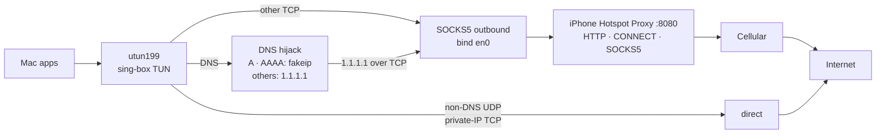

[한국어](../README.md) · English

<p align="center">
  
</p>

<h1 align="center">Hotspot Proxy</h1>

<p align="center">
  Turns your iPhone's Personal Hotspot into a proxy so your Mac's traffic looks like the iPhone's own traffic.<br>
  <sub>Fork of <a href="https://github.com/Indosaram/hotspot-proxy">Indosaram/hotspot-proxy</a> · iOS 26 · IPv6-only carriers</sub>
</p>

<p align="center">
  
  
  
  <a href="https://github.com/Indosaram/hotspot-proxy"></a>
</p>

## Why

Carriers often classify hotspot (tethering) traffic separately, then throttle it or count it against a separate cap. This app runs an HTTP, HTTPS (CONNECT), and SOCKS5 proxy inside the iPhone. When the Mac goes out through that proxy, the carrier sees the traffic as the iPhone's own.

The Mac script turns on a sing-box TUN the moment the Mac joins the hotspot, which sends system-wide TCP traffic and DNS through the proxy. When the Mac leaves the hotspot, the script restores the normal setup. Nothing needs to be configured by hand.

## Screenshots

<table>
  <tr><th>Main (running)</th><th>Hotspot off</th><th>Settings</th><th>Welcome</th></tr>
  <tr>
    <td></td>
    <td></td>
    <td></td>
    <td></td>
  </tr>
  <tr>
    <td></td>
    <td></td>
    <td></td>
    <td></td>
  </tr>
</table>


## How it works



- When the Mac joins the iPhone hotspot, a launchd watcher brings up the sing-box TUN interface `utun199`. It also points Wi-Fi DNS at the TUN address `172.19.0.2`.
- The TUN hijacks every DNS query. For A and AAAA queries, fakeip answers right away with a placeholder address. Connections to that address leave through the proxy carrying the domain name, so the iPhone does the real lookup. All other queries go to 1.1.1.1 over TCP, also through the proxy.
- The rest of the TCP traffic goes to the iPhone proxy. TCP to private IPs and non-DNS UDP skip the proxy. UDP is excluded because SOCKS5 UDP ASSOCIATE fails over a link-local address.
- When the Mac leaves the hotspot, the watcher stops sing-box and clears the DNS override.

On iOS 26 with an IPv6-only carrier, the hotspot gives the Mac `192.0.0.2`. The gateway `192.0.0.1` is a virtual address, and the iPhone app does not answer there. The app only answers on the iPhone's IPv6 link-local address. That is why the original version stopped working.

## Requirements

> [!IMPORTANT]
> You need a paid Apple Developer account. A free Personal Team cannot sign the App Group entitlement. Development signatures from a paid account last one year.

- iPhone: iOS 17 or later with Developer Mode on.
- Mac: Xcode 26.x, Homebrew, `xcodegen`, and `sing-box`. The Xcode SDK must match the iPhone's iOS version.

## Quick start

Run every command from the repository root.

### 1. iPhone app

```bash
brew install xcodegen
cp signing.env.example signing.env      # fill in your team ID and bundle prefix
bash scripts/generate.sh
open HotspotProxy.xcodeproj
```

Sign in to your team account in Xcode, pick the iPhone as the run destination, and press Run. The first time, connect over USB and tap "Trust This Computer". After that, Xcode can install over the same Wi-Fi network. For a terminal-only flow, see [BUILD.md](BUILD.md).

**Check:** the Hotspot Proxy icon appears on the iPhone Home Screen, and tapping it opens the app.

### 2. Mac auto-switching

```bash
brew install sing-box
sudo bash mac/install.sh
```

**Check:** `install.sh` ends with `TUN on` or `Standing by …`. After that, `launchctl print system/com.indo.hotspot-tun.watch` shows `last exit code = 0`. The job runs every 30 seconds and exits, so `state = not running` is normal between runs.

### 3. Use

> [!IMPORTANT]
> Keep the iPhone's Settings › Personal Hotspot screen open. If that screen is closed, the Mac cannot find the hotspot.
>
> Leave the Mac's Wi-Fi manual proxy settings empty. A leftover manual proxy blocks every browser connection whenever the Mac is not on the hotspot.

1. In the iPhone app, tap **Start Proxy**.
2. On the Mac, pick the iPhone from the Wi-Fi menu. The TUN comes up about 2 seconds later.
3. Disconnect from the hotspot, and the Mac goes back to normal about 2 seconds later.

**Check:** while on the hotspot, `cat /usr/local/var/hotspot-tun/mode` prints `hotspot`.

### 4. Verify

```bash
bash mac/check.sh
```

**Check:** items 1 to 5 are OK, and the two public IPs in item 6 match.

| Measured on | Download | Upload | RTT |
|---|---|---|---|
| iPhone 15 Pro · 5G · through the proxy | 56 Mbps | 30 Mbps | 89 ms |

<details><summary><b>What this fork changes</b></summary>

| Area | Original | This fork |
|---|---|---|
| Hotspot detection | Mac IP is in `172.20.10.x` | Default gateway is `172.20.10.1` or `192.0.0.1` |
| Proxy address | Fixed `172.20.10.1` | Tries the v4 gateway first, then falls back to the iPhone's IPv6 link-local address (`fe80::…%en0`) |
| sing-box | Fixed server | Rewrites the server to the detected address and restarts, `bind_interface: en0`, non-DNS UDP goes direct |
| App upstream connections | Treated `.waiting` as failure and dropped the failure reply | Waits through `.waiting` (15-second cap) and closes only after sending the failure reply. Fixes apps that open many connections at once, such as KakaoTalk login |
| Signing | Hard-coded in the spec | Moved to `signing.env` (git-ignored). The app reads the App Group from Info.plist |
| Diagnostics | None | `check.sh`, a state logger, and `watch.log` |

</details>

## Features

- **Lock Screen and Home Screen widgets.** The Lock Screen gets circular, rectangular, and inline widgets, and the Home Screen gets a small one. The app reloads widgets only when the state changes.
- **Deep links.** `hotspotproxy://open`, `start`, `stop`, `toggle`, and `copy` open the app or control the proxy. Use the "Open URLs" action in Shortcuts to automate them.
- **Background keep-alive.** The app loops 30 seconds of 8 kHz silent audio at zero volume to stay alive in the background. The audio mixes with other apps.
- **Status and stats.** A signal ring shows running, hotspot off, stopped, and error states by color. The main screen shows active connections, data transferred, and uptime.
- **Connection guides.** The app includes setup guides for iPhone, Mac, Android, and Windows, plus a Mac auto-TUN guide.
- **Not for the App Store.** The silent-audio background mode may not pass App Store review. The app is meant for personal sideloading and developer-signed builds.

## Repository layout

| Path | Purpose |
|---|---|
| `Sources/`, `Shared/`, `Widget/` | iOS app, shared state, WidgetKit extension |
| `project.yml` | XcodeGen spec. Signing values come from `signing.env` |
| `scripts/generate.sh` | Reads `signing.env` and generates the `.xcodeproj` |
| `mac/install.sh`, `uninstall.sh` | Install and remove the Mac auto-switching daemons (sudo) |
| `mac/hotspot-tun.sh` | Hotspot detection and TUN switching logic |
| `mac/config.json` | sing-box configuration |
| `mac/check.sh` | Reports the current state as OK or FAIL |
| `mac/probe/` | Optional state logger that runs every 20 seconds, for troubleshooting |
| `docs/` | Detailed guides and work notes |

## Troubleshooting, uninstall, and Tailscale

The detailed guide is in Korean only.

**Troubleshooting.** Symptoms, causes, and fixes are in [share-guide section 7](share-guide.md#7-겪은-문제와-해결). To trace a problem yourself, load the state logger from [section 8](share-guide.md#8-원인-추적에-쓴-로거-선택) as a LaunchAgent.

**Uninstall.** `sudo bash mac/uninstall.sh` stops the watcher, sing-box, and the Tailscale CLI daemon, then clears the DNS override. The remaining commands are in [share-guide section 9](share-guide.md#9-되돌리기), and section 8 shows how to unload the state logger.

**Tailscale.** To send Tailscale control traffic through the proxy while on the hotspot, run `sudo bash mac/install-tailscale.sh` exactly once. The wrapper script is in [share-guide section 4](share-guide.md#4-맥-자동-전환-스크립트-수정본), and section 7 covers `Bootstrap failed: 5` from a second run and conflicts with the GUI app.

## Credits and license

The iOS app, widgets, icon, and Mac sing-box automation come from [Indosaram/hotspot-proxy](https://github.com/Indosaram/hotspot-proxy). This fork adds iOS 26 and IPv6-only carrier support plus fixes to upstream connection handling.

The original repository has no license file, so this fork does not state a separate license. Original author: Indosaram (https://github.com/Indosaram/hotspot-proxy)
