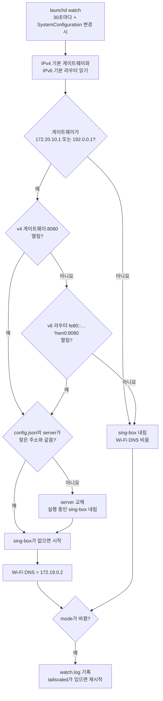

# Hotspot Proxy iOS 26 적용기

- 포크(이 문서 기준): https://github.com/JeongDowny/hotspot-proxy
- 원본 저장소: https://github.com/Indosaram/hotspot-proxy
- 환경: iPhone 15 Pro (iOS 26.6), MacBook Pro (macOS 26.5, Xcode 26.6), IPv6 전용 통신사
- 작성: 2026-10-21

원작 그대로는 이 환경에서 맥 자동 전환이 동작하지 않았다. 아래 순서대로 하면 재현된다.

## 원작과 다른 점 요약

- 이 아이폰의 핫스팟은 맥에 `192.0.0.2`(게이트웨이 `192.0.0.1`)를 준다. 원작이 가정한 `172.20.10.1`이 아니다.
- `192.0.0.1`은 가상 게이트웨이라 아이폰 앱의 프록시 포트가 열려 있지 않다. 앱은 아이폰의 **IPv6 링크로컬 주소**(핫스팟의 IPv6 기본 라우터, `fe80::…%en0`)에서만 응답한다.
- 맥 스크립트를 이 주소를 쓰도록 바꿔야 한다. 아래 스크립트는 `172.20.10.1`과 `192.0.0.1` 둘 다 지원한다.

## 1. 준비물

- iOS 17 이상 아이폰. 설정 › 개인정보 보호 및 보안 › 개발자 모드 켜기.
- Xcode, Homebrew. `brew install xcodegen sing-box`
- Xcode에 로그인된 **유료** Apple 개발자 계정. 앱이 App Group 권한을 쓰기 때문에 무료 Personal Team으로는 서명이 실패한다. 유료 계정 서명은 1년 유효하고, 만료되면 재설치만 하면 된다.
- 아이폰을 최초 1회 USB로 맥에 연결해 "이 컴퓨터를 신뢰"를 누른다. 이후에는 같은 와이파이(아이폰 핫스팟 포함)에서 무선으로 설치된다.

## 2. 앱 빌드와 설치

1. 저장소를 받고 서명 정보를 `signing.env`에 적는다. 이 파일은 git이 무시한다. `scripts/generate.sh`가 이 값을 project.yml에 넣어 `.xcodeproj`, entitlements, Info.plist를 생성한다. App Group 문자열은 Info.plist의 `AppGroupIdentifier`로 앱에 전달된다.

   ```bash
   git clone https://github.com/JeongDowny/hotspot-proxy && cd hotspot-proxy
   cp signing.env.example signing.env   # DEVELOPMENT_TEAM, BUNDLE_PREFIX 입력
   bash scripts/generate.sh
   ```

2. 앱 코드 패치(3장)는 이 포크에 이미 적용되어 있다. 원본에서 작업할 때만 손으로 넣는다.

3. 기기 없이 서명을 먼저 검증한다. `Unable to log in` 또는 `doesn't support the … App Group`이 나오면 Xcode › Settings › Accounts에서 재로그인한다.

   ```bash
   xcodebuild -project HotspotProxy.xcodeproj -scheme HotspotProxy -configuration Debug \
     -destination 'generic/platform=iOS' -allowProvisioningUpdates -derivedDataPath build build
   ```

4. 아이폰 ID를 읽는다. 상태가 `available`이어야 한다. `unavailable`이면 USB를 꽂는다.

   ```bash
   xcrun devicectl list devices   # Identifier(UUID)와, 상세의 UDID(00008130-…)를 쓴다
   ```

5. 빌드, 설치, 실행.

   ```bash
   xcodebuild -project HotspotProxy.xcodeproj -scheme HotspotProxy -configuration Debug \
     -destination 'id=<UDID>' -allowProvisioningUpdates -allowProvisioningDeviceRegistration \
     -derivedDataPath build build
   xcrun devicectl device install app --device <UUID> build/Build/Products/Debug-iphoneos/HotspotProxy.app
   xcrun devicectl device process launch --device <UUID> <BUNDLE_PREFIX>.hotspotproxy
   ```

6. 앱이 안 열리면 아이폰 설정 › 일반 › VPN 및 기기 관리에서 개발자 앱을 신뢰한다.

## 3. 앱 패치: 업스트림 연결 처리

`Sources/ProxyServer.swift`의 `connect(host:port:)`는 NWConnection이 `.waiting`이 되면 즉시 실패로 처리하고, SOCKS 실패 응답을 보내자마자 소켓을 닫아 클라이언트가 응답 대신 EOF를 받는다. 셀룰러에서는 `.waiting`이 잠깐 지나가는 상태라 멀쩡한 연결이 끊긴다. 카카오톡 로그인(LOCO 서버 :995)이 이것 때문에 실패했다. 아래처럼 바꾼다.

```swift
// connect(host:port:) 안의 stateUpdateHandler
case .ready: if !fired { fired = true; done(true) }
case .failed:
    if !fired { fired = true; done(false) } else { self?.close() }
case .waiting:
    break            // 셀룰러에서 흔한 일시 상태. 아래 타이머가 상한을 둔다
case .cancelled: self?.close()
default: break
// up.start(queue: queue) 다음에 추가
queue.asyncAfter(deadline: .now() + 15) { [weak up] in
    guard !fired, let up else { return }
    fired = true; up.cancel(); done(false)
}

// SOCKS CONNECT 처리부 (cmd == 1)
connect(host: host, port: port) { [self] ok in
    if ok { reply(0); pipe() }
    else {   // 실패 응답을 다 보낸 뒤에 닫는다
        client.send(content: Data([5, 5, 0, 1, 0, 0, 0, 0, 0, 0]),
                    completion: .contentProcessed { [weak self] _ in self?.close() })
    }
}
```

## 4. 맥 자동 전환 스크립트 (수정본)

이 포크의 `mac/` 폴더에 이미 반영되어 있다. 원본에서 작업한다면 아래 내용으로 교체한다. 핵심은 세 가지다.

1. 핫스팟 판정을 "기본 게이트웨이가 172.20.10.1 또는 192.0.0.1"로 바꾼다.
2. 프록시 주소를 "v4 게이트웨이:8080이 열리면 그것, 아니면 IPv6 기본 라우터"로 고른다.
3. 고른 주소를 sing-box 설정에 써넣고 재시작한다.

감시 데몬이 한 번 실행될 때의 판단 순서는 아래와 같다.



### mac/hotspot-tun.sh

```bash
#!/bin/bash
# 네트워크 변경 시·30초마다 실행. 핫스팟+프록시 응답이면 TUN 켜고, 아니면 끈다.
LABEL=com.indo.hotspot-tun.singbox
PLIST=/Library/LaunchDaemons/$LABEL.plist
CONF=/usr/local/etc/hotspot-tun/config.json
SVC=Wi-Fi
TUN_DNS=172.19.0.2
GW=$(/sbin/route -n get default 2>/dev/null | /usr/bin/awk '/gateway:/{print $2}')
V6GW=$(/usr/sbin/netstat -rn -f inet6 2>/dev/null | /usr/bin/awk '$1=="default"{print $2; exit}')   # fe80::…%en0
on_hotspot() { [[ "$GW" =~ ^172\.20\.10\.1$ || "$GW" =~ ^192\.0\.0\.1$ ]]; }
PROXY_HOST=""
if on_hotspot; then
  if /usr/bin/nc -z -G 2 "$GW" 8080 >/dev/null 2>&1; then PROXY_HOST="$GW"
  elif [ -n "$V6GW" ] && /usr/bin/nc -z -G 2 "$V6GW" 8080 >/dev/null 2>&1; then PROXY_HOST="$V6GW"; fi
fi
proxy_up() { [ -n "$PROXY_HOST" ]; }
running() { /bin/launchctl print system/$LABEL >/dev/null 2>&1; }
dns_is() { /usr/sbin/networksetup -getdnsservers "$SVC" | grep -qx "$1"; }
if on_hotspot && proxy_up; then
  if ! /usr/bin/grep -q "\"server\": \"$PROXY_HOST\"" "$CONF"; then
    /usr/bin/sed -i '' "s|^      \"server\": \"[0-9a-fA-F.:%a-z]*\",$|      \"server\": \"$PROXY_HOST\",|" "$CONF"  # 6칸 들여쓰기 = socks 아웃바운드만
    running && /bin/launchctl bootout system/$LABEL
  fi
  running || /bin/launchctl bootstrap system "$PLIST"
  dns_is "$TUN_DNS" || /usr/sbin/networksetup -setdnsservers "$SVC" "$TUN_DNS"
else
  running && /bin/launchctl bootout system/$LABEL
  dns_is "$TUN_DNS" && /usr/sbin/networksetup -setdnsservers "$SVC" Empty
fi
MODE_FILE=/usr/local/var/hotspot-tun/mode
if on_hotspot && proxy_up; then MODE=hotspot; else MODE=normal; fi
if [ "$(cat $MODE_FILE 2>/dev/null)" != "$MODE" ]; then
  echo "$MODE" > $MODE_FILE
  echo "$(date '+%F %T') mode=$MODE gw=${GW:-none} v6gw=${V6GW:-none} proxy=${PROXY_HOST:-none}" >> /usr/local/var/hotspot-tun/watch.log
  /bin/launchctl print system/com.indo.tailscaled >/dev/null 2>&1 && /bin/launchctl kickstart -k system/com.indo.tailscaled
fi
exit 0
```

### mac/config.json 변경 2곳

socks 아웃바운드에 `bind_interface`를 넣어 링크로컬 주소로 접속되게 하고, UDP는 프록시를 거치지 않게 한다. 아이폰 앱의 SOCKS5 UDP ASSOCIATE가 링크로컬 환경에서 실패해 오류가 쏟아졌다. TCP와 DNS는 그대로 프록시를 탄다.

```jsonc
"outbounds": [
  { "type": "socks", "tag": "proxy", "server": "172.20.10.1", "server_port": 8080, "version": "5",
    "bind_interface": "en0" },                      // 추가. server 값은 스크립트가 매번 덮어쓴다
  { "type": "direct", "tag": "direct" }
],
"route": { "rules": [
  { "action": "sniff" },
  { "protocol": "dns", "action": "hijack-dns" },
  { "network": "udp", "outbound": "direct" },       // 추가
  { "ip_cidr": ["198.18.0.0/15"], "outbound": "proxy" },
  { "ip_is_private": true, "outbound": "direct" }
], ... }
```

### mac/tailscaled-wrapper.sh (Tailscale CLI를 쓸 때만)

```bash
#!/bin/bash
GW=$(/sbin/route -n get default 2>/dev/null | /usr/bin/awk '/gateway:/{print $2}')
V6GW=$(/usr/sbin/netstat -rn -f inet6 2>/dev/null | /usr/bin/awk '$1=="default"{print $2; exit}')
if [[ "$GW" =~ ^172\.20\.10\.1$ || "$GW" =~ ^192\.0\.0\.1$ ]]; then
  if /usr/bin/nc -z -G 2 "$GW" 8080 >/dev/null 2>&1; then export HTTPS_PROXY=http://$GW:8080 HTTP_PROXY=http://$GW:8080
  elif [ -n "$V6GW" ] && /usr/bin/nc -z -G 2 "$V6GW" 8080 >/dev/null 2>&1; then export HTTPS_PROXY="http://[$V6GW]:8080" HTTP_PROXY="http://[$V6GW]:8080"; fi
fi
exec /opt/homebrew/bin/tailscaled
```

### 설치

sudo는 비밀번호를 받을 수 있는 실제 터미널에서 실행한다. 비대화형 실행(`!` 접두 등)은 `a terminal is required`로 실패한다.

```bash
sudo bash mac/install.sh
sudo install -m 755 mac/tailscaled-wrapper.sh /usr/local/libexec/tailscaled-wrapper.sh   # Tailscale CLI 쓸 때만
```

> **맥 Wi-Fi의 수동 프록시는 비워 둔다.** 시스템 설정 › 네트워크 › Wi-Fi › 세부사항 › 프록시에 172.20.10.1을 넣어 두면 핫스팟이 아닐 때 모든 브라우저 접속이 `ERR_TIMED_OUT`으로 막힌다. 자동 전환을 쓰면 수동 프록시는 필요 없다.

## 5. 사용

1. 아이폰 앱을 열고 Start Proxy를 누른다. 앱 화면에 "Hotspot off"가 떠도 포트는 열려 있으니 무시한다.
2. 아이폰 설정 › 개인용 핫스팟 화면을 열어 둔다. 이 화면이 닫혀 있으면 맥에서 핫스팟이 검색되지 않는다.
3. 맥 메뉴바 Wi-Fi에서 iPhone을 고른다.
4. 약 2초 뒤 자동으로 TUN이 켜진다. 핫스팟을 끊으면 2초 뒤 원래대로 돌아온다.

## 6. 확인

아래를 `mac/check.sh`로 저장하고 핫스팟에 붙은 상태에서 실행한다.

```bash
#!/bin/bash
ok(){ printf "  [OK]   %s\n" "$1"; }; no(){ printf "  [FAIL] %s\n" "$1"; }
GW=$(route -n get default 2>/dev/null | awk '/gateway:/{print $2}')
V6GW=$(netstat -rn -f inet6 2>/dev/null | awk '$1=="default"{print $2; exit}')
echo "== 1. 핫스팟 판정"; [[ "$GW" =~ ^172\.20\.10\.1$ || "$GW" =~ ^192\.0\.0\.1$ ]] && ok "gw $GW" || no "핫스팟 아님 (gw ${GW:-없음})"
PH=""; nc -z -G 2 "$GW" 8080 >/dev/null 2>&1 && PH=$GW; [ -z "$PH" ] && [ -n "$V6GW" ] && nc -z -G 2 "$V6GW" 8080 >/dev/null 2>&1 && PH=$V6GW
echo "== 2. 아이폰 프록시"; [ -n "$PH" ] && ok "$PH:8080 열림" || no "응답 없음. 앱의 Start Proxy 확인"
echo "== 3. 감시 데몬"; launchctl print system/com.indo.hotspot-tun.watch >/dev/null 2>&1 && ok "등록됨 (mode=$(cat /usr/local/var/hotspot-tun/mode 2>/dev/null))" || no "없음"
echo "== 4. sing-box TUN"; launchctl print system/com.indo.hotspot-tun.singbox >/dev/null 2>&1 && ok "sing-box 실행 중" || no "sing-box 꺼짐"; ifconfig utun199 >/dev/null 2>&1 && ok "utun199 있음" || no "utun199 없음"
echo "== 5. DNS"; networksetup -getdnsservers Wi-Fi | grep -qx 172.19.0.2 && ok "DNS 172.19.0.2" || no "DNS 기본값"
echo "== 6. 경로"; echo "  TUN 경유 공인 IP   : $(curl -s -m 8 https://api.ipify.org)"; echo "  프록시 직접 공인 IP: $(curl -s -m 8 --proxy "socks5h://[$PH]:8080" https://api.ipify.org)"
echo "== 7. 로그"; tail -3 /usr/local/var/hotspot-tun/watch.log 2>/dev/null
```

성공 기준: 1~5번 OK, 6번의 두 IP가 같고 맥이 핫스팟으로 직접 나갈 때의 IP와 다르다. 이 환경에서는 직접 118.235.14.x, 프록시 경유 118.235.6.x로 갈렸다. 측정 속도는 프록시 경유 다운 56 Mbps, 업 30 Mbps, RTT 89 ms였다(`networkQuality -s`).

## 7. 겪은 문제와 해결

| 증상 | 원인 | 해결 |
|---|---|---|
| 빌드 시 App Group 오류 | Xcode 계정 로그인 만료, 또는 무료 Personal Team | 유료 팀으로 재로그인 후 `-allowProvisioningUpdates` 빌드 |
| 핫스팟에 붙어도 아무 일도 안 일어남 | 맥 IP가 192.0.0.2라 172.20.10.x 판정에 안 걸림 | 게이트웨이 기반 판정 (4장) |
| 192.0.0.1:8080 닫힘 | 가상 게이트웨이. 앱은 IPv6 링크로컬에서만 응답 | IPv6 기본 라우터 주소 사용 + `bind_interface: en0` |
| sing-box 로그에 UDP 오류 다수 | SOCKS5 UDP ASSOCIATE가 링크로컬에서 실패 | UDP는 direct 규칙 |
| 카카오톡 로그인 실패 (LOCO :995 EOF) | 앱이 `.waiting`을 실패로 처리하고 실패 응답도 유실 | 앱 패치 (3장). 패치 후 :995 연결 ESTABLISHED 확인 |
| Chrome이 모든 사이트에 ERR_TIMED_OUT | Wi-Fi 수동 프록시에 172.20.10.1이 남아 있음 | 수동 프록시 전부 끄기 |
| `install-tailscale.sh`에서 `Bootstrap failed: 5` | 스크립트를 2회 실행해 bootout과 bootstrap이 겹침 | 1회만 실행. 실패 시 `sudo launchctl bootstrap system /Library/LaunchDaemons/com.indo.tailscaled.plist` 후 `tailscale up` |
| Tailscale CLI 전환 후 피어 통신 불가 | GUI 앱의 VPN이 아직 Connected라 경로 충돌 | `scutil --nc stop "Tailscale"` 계열로 GUI VPN 정지, `tailscale down && tailscale up`. 이후 Tailscale.app을 열지 않는다 |

## 8. 원인 추적에 쓴 로거 (선택)

sudo 없이 설치되는 사용자 LaunchAgent로, 20초마다 상태가 바뀔 때만 한 줄을 기록한다. 핫스팟 중에는 아이폰 주소 후보마다 8080을 두드려 어느 주소가 열리는지도 남긴다. 모든 문제를 이 로그로 찾았다. 전체 스크립트는 `mac/probe/probe.sh`에 있다. 폰의 Tailscale IP가 있으면 `PHONE_TAILSCALE_IP` 환경변수로 넘기면 핫스팟과 무관하게 앱 생존을 같이 기록한다. 핵심은 아래 다섯 줄이다.

```bash
GW=$(route -n get default | awk '/gateway:/{print $2}')
V6GW=$(netstat -rn -f inet6 | awk '$1=="default"{print $2; exit}')
for c in "$GW" "$V6GW" $(arp -an -i en0 | awk '{print $2}' | tr -d '()') $(ndp -an | awk '$3 ~ /en0/ {print $1}' | head -6); do
  nc -z -G 2 "$c" 8080 >/dev/null 2>&1 && echo "$c:8080 open" || echo "$c:8080 closed"
done
```

등록과 해제는 저장소 루트에서 실행한다. sudo는 필요 없다. heredoc 안의 `$PWD`가 저장소 경로로 바뀌므로 다른 위치에서 실행하지 않는다.

```bash
# 등록
cat > ~/Library/LaunchAgents/com.local.hotspot-probe.plist <<EOF
<?xml version="1.0" encoding="UTF-8"?>
<!DOCTYPE plist PUBLIC "-//Apple//DTD PLIST 1.0//EN" "http://www.apple.com/DTDs/PropertyList-1.0.dtd">
<plist version="1.0"><dict>
  <key>Label</key><string>com.local.hotspot-probe</string>
  <key>ProgramArguments</key><array><string>/bin/bash</string><string>$PWD/mac/probe/probe.sh</string></array>
  <key>StartInterval</key><integer>20</integer><key>RunAtLoad</key><true/>
  <key>WatchPaths</key><array><string>/Library/Preferences/SystemConfiguration</string></array>
</dict></plist>
EOF
launchctl bootstrap gui/$(id -u) ~/Library/LaunchAgents/com.local.hotspot-probe.plist

# 해제
launchctl bootout gui/$(id -u)/com.local.hotspot-probe
```

## 9. 되돌리기

```bash
sudo bash mac/uninstall.sh                          # 자동 TUN 제거
sudo launchctl bootout system/com.indo.tailscaled   # Tailscale CLI 중지
```
